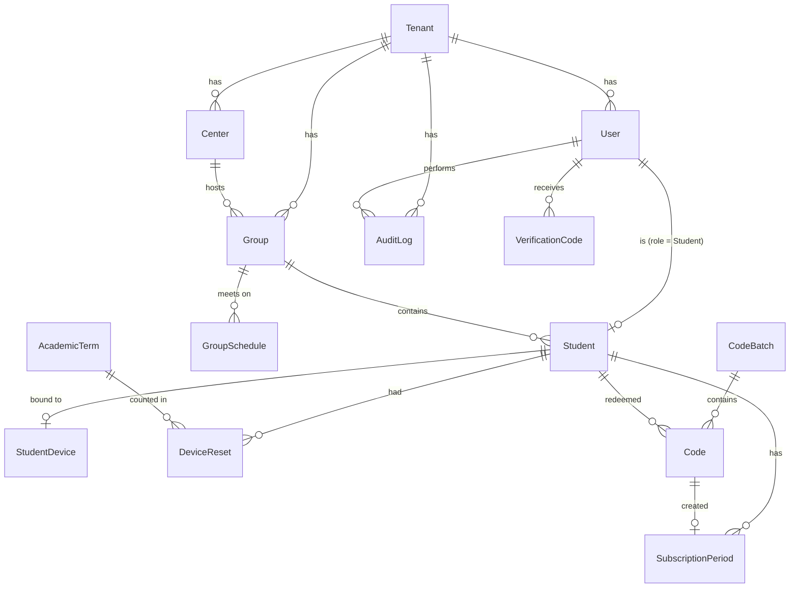

# التحليل: الـ ERD للـ Modules 1 إلى 3

المرحلة: Analysis. مبني على [متطلبات الحسابات والمجموعات](01-requirements-accounts-and-groups.md) و[متطلبات الاشتراكات والأكواد](02-requirements-subscriptions-and-codes.md).

## الفكرة الأساسية: نوعين جداول

| النوع | المعنى | الجداول |
|---|---|---|
| **جداول المنصة** | مش تابعة لمدرس. أدمن المنصة بس اللي بيشوفها. | `Tenant`، `CodeBatch`، `Code`، `AcademicTerm` |
| **جداول المدرس** | فيها `TenantId`، وبتتفلتر تلقائي بالمدرس الحالي. | كل الباقي |

`Tenant` هو "مساحة المدرس": كل مدرس ليه `Tenant` واحد، وكل بياناته مربوطة بيه.

## الرسم

## الجداول

### جداول المنصة

**Tenant** (مساحة المدرس)

| العمود | ملاحظات |
|---|---|
| Id | |
| Slug | اسم اللينك. فريد على المنصة كلها. |
| DisplayName | اسم المدرس اللي بيظهر للطلاب. |
| LogoUrl | اختياري. |
| IsActive | أدمن المنصة يقدر يوقف مدرس. |

**CodeBatch** (دفعة أكواد)

| العمود | ملاحظات |
|---|---|
| Id | |
| Type | Activation أو Subscription. |
| Count | عدد الأكواد. |
| DurationDays | 7 للتفعيل، 30 للاشتراك. متخزنة في الدفعة عشان لو المدة اتغيرت بعدين، الأكواد القديمة تفضل بمدتها. |
| Note | اختياري. |
| CreatedByUserId | الأدمن اللي ولّدها. |

**Code**

| العمود | ملاحظات |
|---|---|
| Id | |
| BatchId | |
| Value | الكود نفسه. فريد. |
| Status | Available أو Used أو Voided. |
| UsedByStudentId | بيتملى وقت الاستخدام. |
| UsedInTenantId | عشان نعرف كل مدرس اتستخدم عنده كام كود. |
| UsedAt | |

**AcademicTerm** (الترم)

| العمود | ملاحظات |
|---|---|
| Id | |
| Name | مثلاً "الترم الأول 2027/2028". |
| StartDate, EndDate | بيتحسب منهم حد "تغيير الجهاز مرتين في الترم". |

### جداول المدرس (كلها فيها `TenantId`)

**User** (أي حد بيدخل المنصة)

| العمود | ملاحظات |
|---|---|
| Id | |
| TenantId | فاضي لأدمن المنصة بس. |
| Role | PlatformAdmin أو Teacher أو Assistant أو Student. |
| FullName | |
| PhoneNumber | فريد **جوه نفس المدرس**، مش على المنصة كلها. نفس الرقم ممكن يبقى طالب عند مدرسين. |
| PasswordHash | فاضي لحد ما الحساب يتفعّل. |
| IsActive | للإيقاف. |
| TwoFactorEnabled | إجباري للمدرس والمساعد. |

**Student** (بيانات الطالب الزيادة)

| العمود | ملاحظات |
|---|---|
| Id | |
| UserId | واحد لواحد مع `User`. |
| GroupId | الطالب في مجموعة واحدة. السنة الدراسية بتيجي من المجموعة. |
| ParentName | |
| ParentWhatsApp | بيظهر متخفي للمساعد. |
| ParentConsentAt | وقت موافقة ولي الأمر على الرسايل. فاضي = مفيش رسايل. |
| HideFromHonorBoard | طلب ولي الأمر. |
| ActivatedAt | وقت استخدام كود التفعيل. |
| AccessEndsAt | آخر يوم مسموحله. بيتحدّث مع كل `SubscriptionPeriod` جديدة، عشان فحص الدخول يبقى سريع. |

**StudentDevice** (الجهاز المربوط)

| العمود | ملاحظات |
|---|---|
| StudentId | صف واحد لكل طالب. |
| DeviceId | معرّف الجهاز من التطبيق. |
| BoundAt | |

**DeviceReset** (سجل فك ربط الجهاز)

| العمود | ملاحظات |
|---|---|
| Id | |
| StudentId | |
| AcademicTermId | عدد الصفوف لنفس الطالب والترم مايزيدش عن 2. |
| ResetByUserId | المدرس أو المساعد. |
| ResetAt | |

**SubscriptionPeriod** (فترة سماح)

| العمود | ملاحظات |
|---|---|
| Id | |
| StudentId | |
| Type | Trial أو Paid. |
| StartsAt, EndsAt | |
| Source | ActivationCode أو SubscriptionCode. بعدين: Paymob. |
| CodeId | الكود اللي عمل الفترة دي. |

كل فترة صف جديد، ومفيش صف بيتعدل. كده تاريخ اشتراكات الطالب كله محفوظ.

**Center** (السنتر)

| العمود | ملاحظات |
|---|---|
| Id, Name, Address | |

**Group** (المجموعة)

| العمود | ملاحظات |
|---|---|
| Id, Name | |
| GradeLevel | من 1 (أولى إعدادي) لـ 6 (تالتة ثانوي). |
| CenterId | فاضي لو المجموعة أونلاين. |
| IsActive | |

**GroupSchedule** (ميعاد)

| العمود | ملاحظات |
|---|---|
| Id, GroupId | |
| DayOfWeek | |
| StartTime, EndTime | |

مجموعة "سبت وتلات" ليها صفين هنا.

**VerificationCode** (كود التحقق من خطوتين)

| العمود | ملاحظات |
|---|---|
| Id, UserId | |
| CodeHash | الكود مش متخزن زي ما هو. |
| ExpiresAt, ConsumedAt | |

**AuditLog** (سجل العمليات)

| العمود | ملاحظات |
|---|---|
| Id | |
| UserId | مين. |
| Action | Created أو Updated أو Deleted أو عملية خاصة زي DeviceReset. |
| EntityName, EntityId | على إيه. |
| Details | القيم قبل وبعد. |
| CreatedAt | إمتى. |

صفوف بتتضاف بس. مفيش تعديل ولا حذف.

## قواعد الشغل

| # | القاعدة |
|---|---|
| R1 | أي query على جدول فيه `TenantId` بتتفلتر تلقائي بالمدرس الحالي. |
| R2 | `PhoneNumber` فريد جوه الـ `Tenant`. |
| R3 | الكود بيتستخدم مرة واحدة. لو طالبين دخّلوا نفس الكود في نفس اللحظة، واحد بس ينجح. |
| R4 | كود التفعيل بيعمل `SubscriptionPeriod` نوعها Trial مدتها 7 أيام من لحظة التفعيل. |
| R5 | كود الاشتراك بيعمل فترة Paid مدتها 30 يوم، بتبدأ من `AccessEndsAt` لو لسه في المستقبل، أو من دلوقتي لو عدّى. |
| R6 | الطالب مسموحله لو `AccessEndsAt` لسه مجاش. |
| R7 | الطالب بيدخل من الجهاز المربوط بس. لو مفيش جهاز مربوط، أول جهاز بيتربط. |
| R8 | فك ربط الجهاز مرتين كحد أقصى لكل طالب في الترم. |
| R9 | المساعد الموقوف مايدخلش، وجلساته المفتوحة بتتقفل. |
| R10 | أي تعديل من مساعد بيتسجل في `AuditLog`. |

## نقط اتحسمت بافتراض

التلات نقط دي مش في ملف المميزات، ومشيت فيها باقتراح. محتاجة تأكيد قبل مرحلة الـ Design.

| # | النقطة | الاقتراح | السبب |
|---|---|---|---|
| Q1 | كود التحقق من خطوتين بيوصل إزاي؟ | تطبيق authenticator (زي Google Authenticator) | مجاني. الـ SMS بفلوس على كل رسالة. |
| Q2 | "الترم" بيتحدد إزاي؟ | أدمن المنصة بيدخّل تاريخ بداية ونهاية كل ترم | الحد "مرتين في الترم" محتاج تواريخ ثابتة. |
| Q3 | الطالب بيتسجل إزاي؟ | المساعد بيضيفه الأول، والطالب بيفعّل بالرقم والكود | عشان مايدخلش حد مش من طلاب المدرس. |
