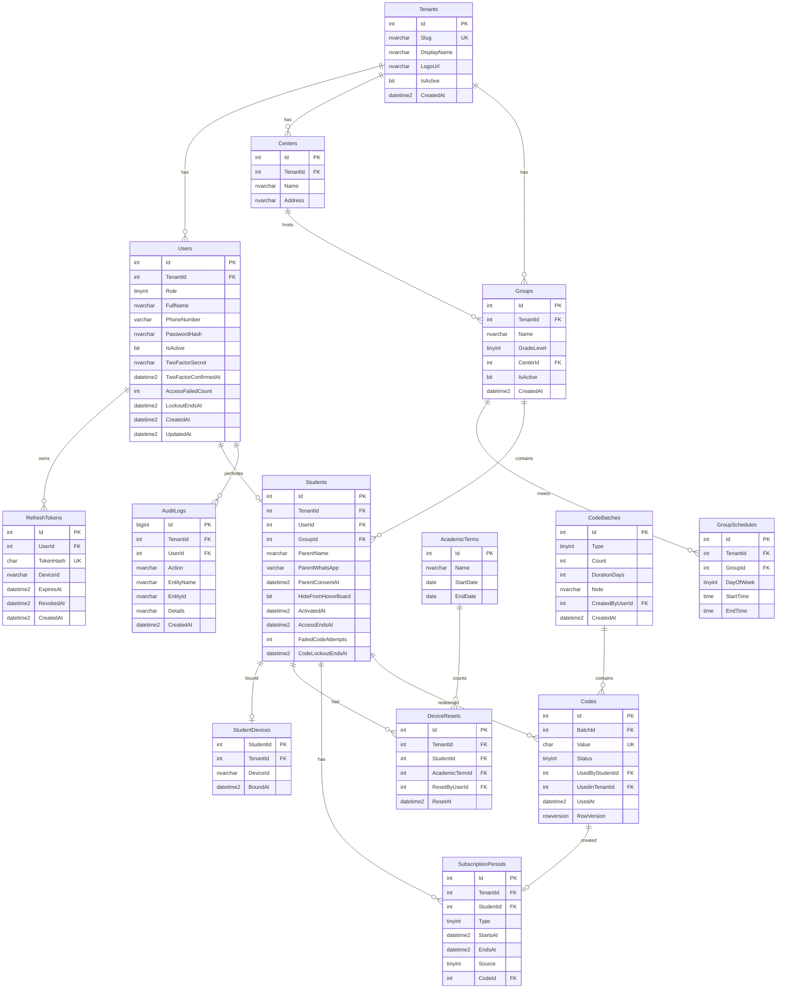

# التصميم: الـ Database Schema للـ Modules 1 إلى 3

المرحلة: Design. مبني على [الـ ERD](03-analysis-erd-modules-1-3.md).

الـ ERD بيقول **إيه الجداول وعلاقتها ببعض**. الملف ده بيقول **كل جدول هيتعمل إزاي في SQL Server**: نوع كل عمود، المفاتيح، والقيود.

## تحديث: قاعدة البيانات PostgreSQL

بعد كتابة الملف ده اتقرر استخدام **PostgreSQL** بدل SQL Server. الجداول والأعمدة والعلاقات زي ما هي، والفرق في الأسماء والأنواع بس:

| في الملف ده | في PostgreSQL |
|---|---|
| أسماء زي `Users`، `TenantId` | snake_case: `users`، `tenant_id` |
| `nvarchar(n)` و `varchar(n)` | `character varying(n)` |
| `char(n)` | `character(n)` |
| `datetime2` | `timestamp with time zone` |
| `bit` | `boolean` |
| `tinyint` (الـ enums) | `integer` |
| `nvarchar(max)` في `AuditLogs.Details` | `jsonb` |
| `rowversion` في `Codes` | العمود الداخلي `xmin`، فمفيش عمود زيادة |

تغييرين كمان في التنفيذ:

- كل الجداول فيها `created_at` و `updated_at`، وبيتملوا تلقائي وقت الحفظ. الاستثناء `student_devices`.
- `DeviceResets.ResetAt` اتشال، و `created_at` هو وقت فك الربط.

الـ schema الفعلي دايمًا هو اللي في الـ migrations: [Data/Migrations](../E-learning.Infra/Data/Migrations/).

## قواعد عامة

- كل `Id` نوعه `int IDENTITY`، ماعدا `AuditLogs` نوعه `bigint`.
- كل التواريخ `datetime2` ومتخزنة UTC.
- الـ enums متخزنة `tinyint`.
- أي جدول فيه `TenantId` عليه global query filter (القاعدة R1).
- مفيش cascade delete بين الجداول، ماعدا `GroupSchedules` مع `Groups`.

## الرسم

## الـ enums

| الاسم | القيم |
|---|---|
| `UserRole` | 1 PlatformAdmin، 2 Teacher، 3 Assistant، 4 Student |
| `GradeLevel` | 1 أولى إعدادي، 2 تانية إعدادي، 3 تالتة إعدادي، 4 أولى ثانوي، 5 تانية ثانوي، 6 تالتة ثانوي |
| `CodeType` | 1 Activation، 2 Subscription |
| `CodeStatus` | 1 Available، 2 Used، 3 Voided |
| `PeriodType` | 1 Trial، 2 Paid |
| `PeriodSource` | 1 ActivationCode، 2 SubscriptionCode (بعدين: 3 Paymob) |

## جداول المنصة

### Tenants

| العمود | النوع | Null | قيود |
|---|---|---|---|
| Id | int | لأ | PK |
| Slug | nvarchar(50) | لأ | Unique |
| DisplayName | nvarchar(150) | لأ | |
| LogoUrl | nvarchar(500) | أيوه | |
| IsActive | bit | لأ | default 1 |
| CreatedAt | datetime2 | لأ | |

### AcademicTerms

| العمود | النوع | Null | قيود |
|---|---|---|---|
| Id | int | لأ | PK |
| Name | nvarchar(100) | لأ | |
| StartDate | date | لأ | |
| EndDate | date | لأ | CHECK EndDate > StartDate |

### CodeBatches

| العمود | النوع | Null | قيود |
|---|---|---|---|
| Id | int | لأ | PK |
| Type | tinyint | لأ | `CodeType` |
| Count | int | لأ | CHECK Count > 0 |
| DurationDays | int | لأ | CHECK DurationDays > 0 |
| Note | nvarchar(200) | أيوه | |
| CreatedByUserId | int | لأ | FK → Users |
| CreatedAt | datetime2 | لأ | |

### Codes

| العمود | النوع | Null | قيود |
|---|---|---|---|
| Id | int | لأ | PK |
| BatchId | int | لأ | FK → CodeBatches |
| Value | char(12) | لأ | Unique. متخزن من غير الشرطات. |
| Status | tinyint | لأ | `CodeStatus`، default 1 |
| UsedByStudentId | int | أيوه | FK → Students |
| UsedInTenantId | int | أيوه | FK → Tenants |
| UsedAt | datetime2 | أيوه | |
| RowVersion | rowversion | لأ | concurrency token |

Indexes: `(BatchId, Status)`، `(UsedInTenantId)`.

`RowVersion` هو اللي بيطبق القاعدة R3: لو طالبين دخّلوا نفس الكود في نفس اللحظة، التاني بياخد خطأ والكود مايتستخدمش مرتين.

## جداول المدرس

### Users

| العمود | النوع | Null | قيود |
|---|---|---|---|
| Id | int | لأ | PK |
| TenantId | int | أيوه | FK → Tenants. فاضي لأدمن المنصة بس. |
| Role | tinyint | لأ | `UserRole` |
| FullName | nvarchar(150) | لأ | |
| PhoneNumber | varchar(15) | لأ | |
| PasswordHash | nvarchar(500) | أيوه | فاضي لحد التفعيل |
| IsActive | bit | لأ | default 1 |
| TwoFactorSecret | nvarchar(200) | أيوه | متشفر. للمدرس والمساعد. |
| TwoFactorConfirmedAt | datetime2 | أيوه | |
| AccessFailedCount | int | لأ | default 0 |
| LockoutEndsAt | datetime2 | أيوه | قفل مؤقت بعد محاولات غلط |
| CreatedAt | datetime2 | لأ | |
| UpdatedAt | datetime2 | أيوه | |

Unique: `(TenantId, PhoneNumber)`. ده اللي بيطبق القاعدة R2.

### RefreshTokens

| العمود | النوع | Null | قيود |
|---|---|---|---|
| Id | int | لأ | PK |
| UserId | int | لأ | FK → Users |
| TokenHash | char(64) | لأ | Unique. الـ token نفسه مش متخزن. |
| DeviceId | nvarchar(100) | أيوه | |
| ExpiresAt | datetime2 | لأ | |
| RevokedAt | datetime2 | أيوه | |
| CreatedAt | datetime2 | لأ | |

Index: `(UserId)`.

الجدول ده بيطبق القاعدة R9: إيقاف مساعد = إلغاء كل الـ tokens بتاعته، فجلساته بتتقفل.

### Centers

| العمود | النوع | Null | قيود |
|---|---|---|---|
| Id | int | لأ | PK |
| TenantId | int | لأ | FK → Tenants |
| Name | nvarchar(150) | لأ | |
| Address | nvarchar(300) | أيوه | |

### Groups

| العمود | النوع | Null | قيود |
|---|---|---|---|
| Id | int | لأ | PK |
| TenantId | int | لأ | FK → Tenants |
| Name | nvarchar(150) | لأ | |
| GradeLevel | tinyint | لأ | CHECK بين 1 و 6 |
| CenterId | int | أيوه | FK → Centers. فاضي = أونلاين. |
| IsActive | bit | لأ | default 1 |
| CreatedAt | datetime2 | لأ | |

Index: `(TenantId, GradeLevel)`.

### GroupSchedules

| العمود | النوع | Null | قيود |
|---|---|---|---|
| Id | int | لأ | PK |
| TenantId | int | لأ | FK → Tenants |
| GroupId | int | لأ | FK → Groups، cascade delete |
| DayOfWeek | tinyint | لأ | 0 الأحد لحد 6 السبت |
| StartTime | time | لأ | |
| EndTime | time | لأ | CHECK EndTime > StartTime |

Unique: `(GroupId, DayOfWeek, StartTime)`.

### Students

| العمود | النوع | Null | قيود |
|---|---|---|---|
| Id | int | لأ | PK |
| TenantId | int | لأ | FK → Tenants |
| UserId | int | لأ | FK → Users، Unique |
| GroupId | int | لأ | FK → Groups |
| ParentName | nvarchar(150) | لأ | |
| ParentWhatsApp | varchar(15) | لأ | |
| ParentConsentAt | datetime2 | أيوه | |
| HideFromHonorBoard | bit | لأ | default 0 |
| ActivatedAt | datetime2 | أيوه | |
| AccessEndsAt | datetime2 | أيوه | |
| FailedCodeAttempts | int | لأ | default 0 |
| CodeLockoutEndsAt | datetime2 | أيوه | قفل 15 دقيقة بعد 5 محاولات (S-09) |

Indexes: `(TenantId, GroupId)`، `(TenantId, AccessEndsAt)`.

### StudentDevices

| العمود | النوع | Null | قيود |
|---|---|---|---|
| StudentId | int | لأ | PK و FK → Students |
| TenantId | int | لأ | FK → Tenants |
| DeviceId | nvarchar(100) | لأ | |
| BoundAt | datetime2 | لأ | |

الـ PK على `StudentId` هو اللي بيضمن جهاز واحد لكل طالب (R7).

### DeviceResets

| العمود | النوع | Null | قيود |
|---|---|---|---|
| Id | int | لأ | PK |
| TenantId | int | لأ | FK → Tenants |
| StudentId | int | لأ | FK → Students |
| AcademicTermId | int | لأ | FK → AcademicTerms |
| ResetByUserId | int | لأ | FK → Users |
| ResetAt | datetime2 | لأ | |

Index: `(StudentId, AcademicTermId)`. حد المرتين (R8) بيتفحص في الـ service قبل الإضافة.

### SubscriptionPeriods

| العمود | النوع | Null | قيود |
|---|---|---|---|
| Id | int | لأ | PK |
| TenantId | int | لأ | FK → Tenants |
| StudentId | int | لأ | FK → Students |
| Type | tinyint | لأ | `PeriodType` |
| StartsAt | datetime2 | لأ | |
| EndsAt | datetime2 | لأ | CHECK EndsAt > StartsAt |
| Source | tinyint | لأ | `PeriodSource` |
| CodeId | int | أيوه | FK → Codes، Unique لو مش فاضي |

Index: `(StudentId, EndsAt)`.

### AuditLogs

| العمود | النوع | Null | قيود |
|---|---|---|---|
| Id | bigint | لأ | PK |
| TenantId | int | لأ | FK → Tenants |
| UserId | int | لأ | FK → Users |
| Action | nvarchar(50) | لأ | |
| EntityName | nvarchar(100) | لأ | |
| EntityId | nvarchar(50) | لأ | |
| Details | nvarchar(max) | أيوه | JSON فيه القيم قبل وبعد |
| CreatedAt | datetime2 | لأ | |

Indexes: `(TenantId, CreatedAt)`، `(TenantId, UserId, CreatedAt)`.

## تغييرات عن الـ ERD

| التغيير | السبب |
|---|---|
| جدول `VerificationCode` اتشال، واتضاف `TwoFactorSecret` في `Users` | تطبيق الـ authenticator بيولّد الكود على موبايل المستخدم، فمفيش أكواد تتخزن. مبني على الاقتراح Q1 اللي لسه محتاج تأكيد. |
| جدول `RefreshTokens` اتضاف | محتاجينه عشان نقفل جلسات المساعد الموقوف (R9). |
| `FailedCodeAttempts` و `CodeLockoutEndsAt` اتضافوا في `Students` | للحماية من تخمين الأكواد (S-09). |
| `AccessFailedCount` و `LockoutEndsAt` اتضافوا في `Users` | لقفل الحساب بعد محاولات دخول غلط (T-02). |

## قرار تصميم: جدول Users خاص بينا

مش هنستخدم جداول ASP.NET Identity الجاهزة. هنعمل جدول `Users` بتاعنا، ونستخدم من Identity الـ `PasswordHasher` بس.

السبب: Identity بيفترض إن اسم المستخدم فريد على النظام كله. عندنا نفس رقم الموبايل ممكن يبقى طالب عند مدرسين، فالفريد هو `(TenantId, PhoneNumber)`.
