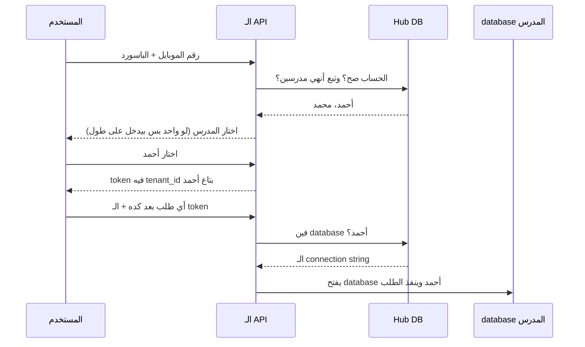

# التصميم: الـ Hub و database لكل مدرس

المرحلة: Design. القرار اتاخد يوم 22 نوفمبر 2026.

الملف ده **بيلغي** اللي في [03](03-analysis-erd-modules-1-3.md) و [04](04-design-database-schema.md) بخصوص مكان الجداول والـ `TenantId`. قواعد الشغل والمتطلبات زي ما هي.

## الفكرة

في نوعين databases:

| | الـ Hub | database المدرس (E-Learning) |
|---|---|---|
| العدد | واحدة للمنصة كلها | واحدة لكل مدرس |
| فيها إيه | الحسابات والدخول، المدرسين ومكان database كل واحد، الأكواد | بيانات المدرس ده بس |
| الاسم في التطوير | `elearning_hub` | `elearning_demo` (المدرس التجريبي) |

مفيش `TenantId` في جداول المدرس، لأن الـ database كلها بتاعته.

## الدخول

حساب واحد لكل شخص على المنصة كلها، برقم الموبايل.

الطالب اللي عند مدرسين بيدخل مرة واحدة، ويبدّل بين المدرسين من غير ما يكتب الباسورد تاني.

## جداول الـ Hub

| الجدول | بيعمل إيه |
|---|---|
| `tenants` | المدرسين. فيه الـ `slug` والـ `connection_string` بتاع database كل مدرس. |
| `accounts` | حساب لكل شخص: الاسم، رقم الموبايل (فريد على المنصة كلها)، الباسورد، التحقق من خطوتين. فيه علامة `is_platform_admin` لفريق المنصة. |
| `memberships` | "الحساب ده تبع المدرس ده" ودوره عنده (مدرس، مساعد، طالب). الطالب اللي عند مدرسين ليه صفين. دي القايمة اللي بتتعرض بعد الدخول. |
| `refresh_tokens` | جلسات الدخول. |
| `account_devices` | الجهاز المربوط بحساب الطالب. صف واحد لكل حساب. |
| `device_resets` | سجل فك ربط الجهاز (مرتين في الترم كحد أقصى). |
| `academic_terms` | تواريخ كل ترم. |
| `code_batches` و `codes` | دفعات الأكواد والأكواد نفسها. |

## جداول database المدرس

| الجدول | بيعمل إيه |
|---|---|
| `users` | الأشخاص عند المدرس ده: الاسم، الرقم، الدور، وموقوف ولا لأ. فيه `hub_account_id` بيربطه بالحساب في الـ Hub. مفيش باسورد هنا. |
| `centers` | السناتر. |
| `groups` و `group_schedules` | المجموعات ومواعيدها. |
| `students` | بيانات الطالب عند المدرس ده: مجموعته، ولي الأمر، التفعيل، وآخر يوم مسموحله. |
| `subscription_periods` | فترات الاشتراك عند المدرس ده. |
| `audit_logs` | سجل العمليات. |

## الربط بين الاتنين

الجدولين في databases مختلفة، فمفيش foreign key بينهم. الربط بالأرقام:

| في database المدرس | بيشاور على (في الـ Hub) |
|---|---|
| `users.hub_account_id` | `accounts.id` |
| `subscription_periods.hub_code_id` | `codes.id` |

وفي الـ Hub: `memberships.tenant_user_id` بيشاور على `users.id` في database المدرس.

## قرارات اتغيرت

| القرار القديم | القرار الجديد |
|---|---|
| database واحدة فيها `TenantId` على كل جدول | database لكل مدرس + Hub مركزية |
| الطالب ليه حساب منفصل عند كل مدرس (A1) | حساب واحد، وبيختار المدرس بعد الدخول |
| رقم الموبايل فريد جوه المدرس | فريد على المنصة كلها |
| ربط الجهاز لكل طالب عند كل مدرس | ربط الجهاز للحساب كله |

اللي **ماتغيرش**: الاشتراك والفترة المجانية لسه لكل مدرس. الطالب اللي عند مدرسين محتاج كود تفعيل وكود اشتراك عند كل واحد.

## نقطة لازم ناخد بالنا منها في الكود

إدخال كود الاشتراك بيعدّل في الاتنين: الكود في الـ Hub، وفترة الاشتراك في database المدرس. مفيش transaction واحدة تغطي الاتنين، فالترتيب هيبقى:

1. نعلّم الكود "مستخدم" في الـ Hub.
2. نضيف فترة الاشتراك في database المدرس.
3. لو الخطوة 2 فشلت، نرجّع الكود "متاح".

## مدرس جديد

تسجيل مدرس جديد معناه: صف في `tenants` + إنشاء database جديدة ليه. المشروع عند التشغيل بيعدّي على كل المدرسين في الـ Hub ويحدّث database كل واحد، ولو مش موجودة بينشئها.
